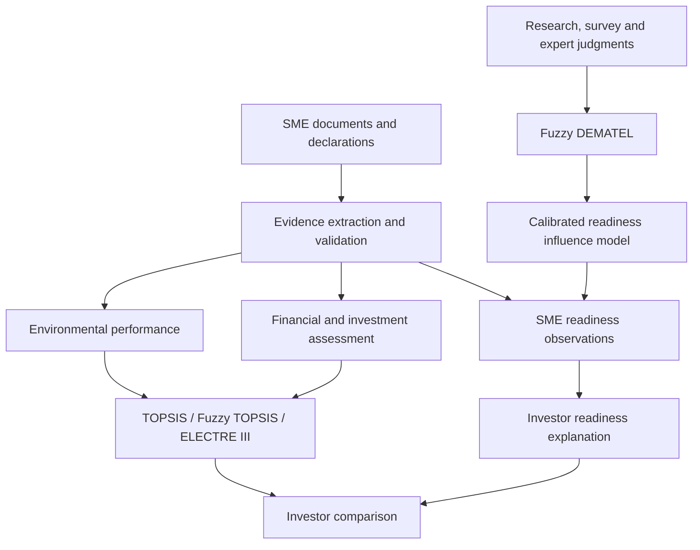

# Architecture

GREENSMECAPT separates evidence capture, applicant interpretation and comparison so that research constructs are not silently converted into scores.

## Core layers

| Layer | Question | Output |
|---|---|---|
| Evidence | What is supported, by which source, with what scope? | Validated observations and provenance |
| Readiness | What enables or obstructs this SME's transition? | Factor states plus calibrated causal interpretation |
| Environmental performance | How is the SME performing environmentally? | Comparable environmental criteria |
| Financial assessment | Can the SME and funding request support the transaction? | Financial health and investment context |
| Decision support | How do eligible SMEs compare under explicit assumptions? | Rankings, outranking, incomparability and robustness |

## Readiness and DEMATEL

The DEMATEL specification uses four research-grounded domains: financing and investor conditions; institutional, regulatory and ecosystem conditions; organisational and capability readiness; and market, procurement and supply-chain conditions. DEMATEL operates on their subdrivers.

No expert pairwise matrix is currently bundled. Unknown influence is therefore unresolved, not zero. The fuzzy linguistic scale is a development placeholder. DEMATEL results may explain an applicant's observed readiness bottlenecks after calibration; they must not produce environmental or financial criterion weights automatically.

## Performance comparison

Environmental and financial criteria remain separate from readiness. Absolute electricity, water, emissions and waste values are evidence until reporting period, operational scope and appropriate denominator, trend or benchmark are established. Versioned normalization and ELECTRE configurations remain provisional and require expert and empirical calibration.

Evidence strength is provenance metadata and a confidence signal. It must not be silently substituted for measured performance.
