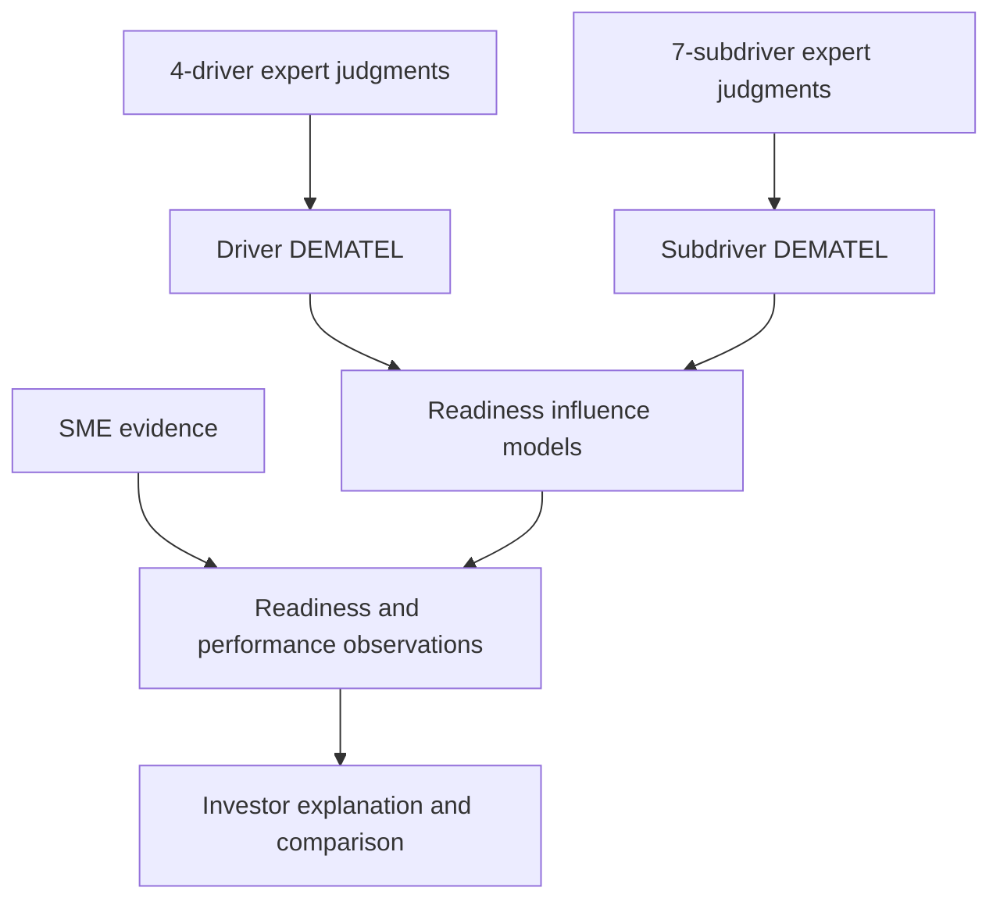

# Architecture

GREENSMECAPT separates evidence capture, applicant interpretation and comparison so that research constructs are not silently converted into scores.

## Core layers

| Layer | Question | Output |
|---|---|---|
| Evidence | What is supported, by which source, with what scope? | Validated observations and provenance |
| Readiness | What enables or obstructs this SME's transition? | Factor states plus calibrated causal interpretation |
| Environmental performance | How is the SME performing environmentally? | Comparable environmental criteria |
| Financial assessment | Can the SME and funding request support the transaction? | Financial health and investment context |
| Decision support | How do eligible SMEs compare under explicit assumptions? | Rankings, outranking, incomparability and robustness |

## Readiness and DEMATEL

The official drivers are:

1. Internal Factors
2. Government & Institutional Support
3. Market Conditions
4. Access to Finance

Seven operational subdrivers sit beneath them: three internal, two government/institutional, one market and one finance subdriver.

The driver-level matrix requires 12 directional judgments per expert. The seven-subdriver matrix requires 42. Collecting both requires at most 54. Each is a complete off-diagonal DEMATEL matrix and uses the same aggregation, normalization, total-relation, D, R, prominence and cause/effect calculations.

The two result sets are reported as complementary levels; they are not automatically multiplied together or converted into environmental or financial criterion weights.

No expert pairwise matrix is bundled. Unknown influence is unresolved, not zero. The fuzzy linguistic scale remains a development placeholder.

## Performance comparison

Environmental and financial criteria remain separate from readiness. Absolute electricity, water, emissions and waste values are evidence until reporting period, operational scope and an appropriate denominator, trend or benchmark are established. Normalization and ELECTRE configurations remain provisional and require calibration.

Evidence strength is provenance metadata and a confidence signal. It must not be substituted for measured performance.
